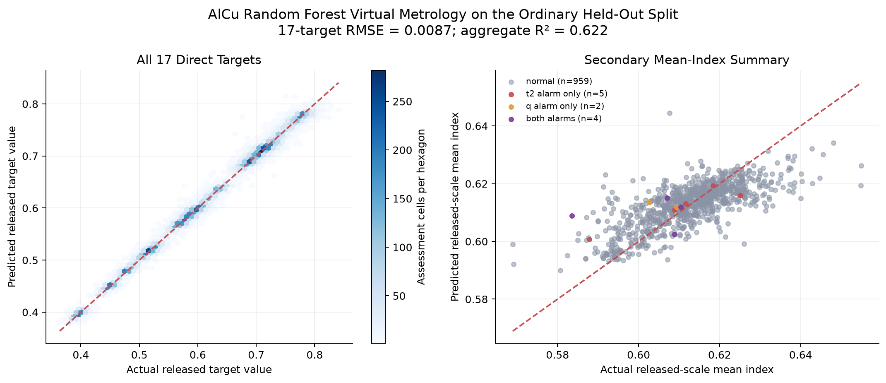
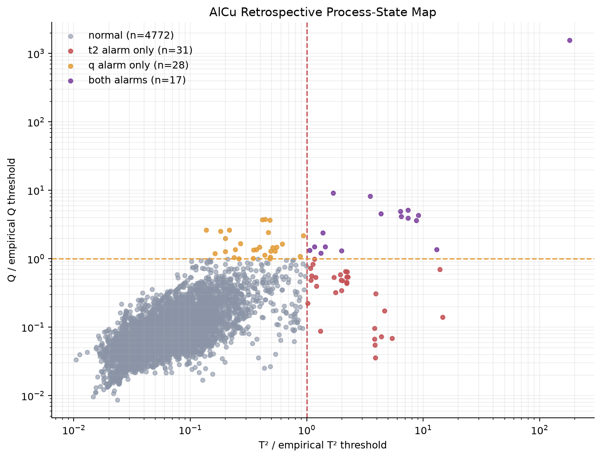
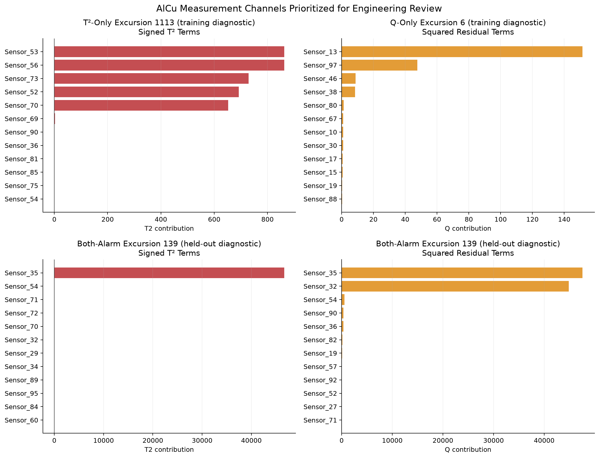
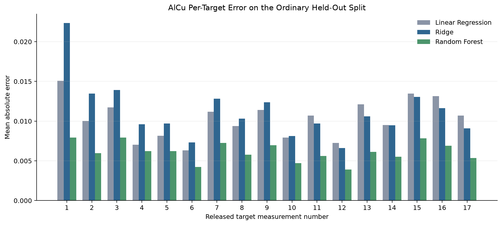
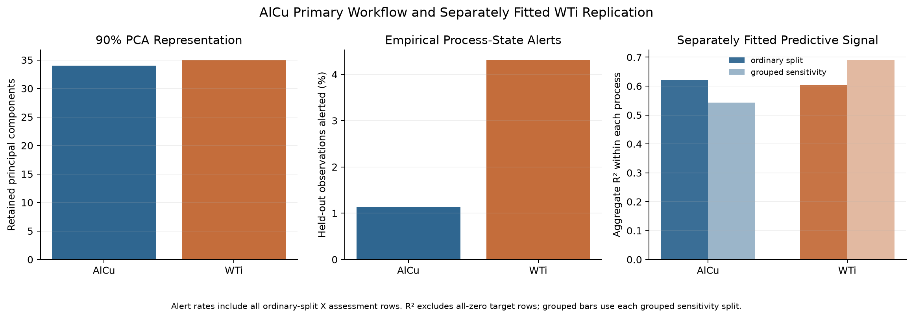

# Multivariate PVD Process Monitoring and Virtual Metrology

<p align="center"><a href="#overview">Overview</a> · <a href="#data">Data</a> · <a href="#method">Method</a> · <a href="#results">Results</a> · <a href="#limits">Limits</a> · <a href="#usage">Usage</a> · <a href="#references">References</a> · <a href="#terms">Terms</a></p>

In 308 of the 970 aluminum-copper coating runs set aside for testing, all 17 measurements of the finished film matched a profile in the training data. When I kept each profile on one side of the split, prediction error rose 6.4%. I repeated the test on tungsten-titanium. There, grouping the profiles reduced error.

## Key results

- **Predicting film measurements.** On a random 80/20 split, a random forest cut root-mean-square error (RMSE) across the 17 measurements by 41% for aluminum-copper (AlCu) and 43% for tungsten-titanium (WTi), compared with ridge regression.
- **Screening process readings.** Eleven of 970 held-out AlCu runs tripped an alert. Four tripped both alarms. The 95% intervals for the differences between those 11 and the other 959 included zero on both the mean of the 17 measurements and the deviation from a reference profile.



## Overview

In physical vapor deposition (PVD), a tool coats a wafer with a thin metal film. Infineon’s public data pair the readings from each run with 17 measurements of the finished film. I used the readings to predict those measurements and to investigate runs where the sensors behaved unusually.

I developed the analysis on 4,848 AlCu records, then fitted separate models to 1,740 WTi records. Each coating has its own input channels and measurement scale.

> [!NOTE]
> <sub>PVD: step that deposits thin metal films on wafers · AlCu, WTi: the two metal layers in the data · virtual metrology: predicting a measurement from process inputs · target: one of 17 released measurements · excursion: a record far from the typical process state</sub>

## Data

The data come from Infineon's public
[Public Infineon AlCu and WTi deposition dataset](https://doi.org/10.5281/zenodo.16881338).

| Process | Input columns | Released targets | Rows |
|---|---:|---:|---:|
| AlCu | 97 | 17 | 4,848 |
| WTi | 108 | 17 | 1,740 |

My four local CSV files are unchanged copies of the release, and they match its MD5 checksums. Git ignores them.

Amina Mević, Andreas Laber, and Senka Krivić published the dataset under
[CC BY 4.0](https://creativecommons.org/licenses/by/4.0/). Download steps and checksums are in [`data/raw/README.md`](data/raw/README.md).

> [!IMPORTANT]
> The release leaves out physical units, inverse scaling, timestamps, equipment identifiers, measurement-point coordinates, specifications, and fault labels. So every number here stays on the released scale. The mean index and reference-profile deviation are summaries I derived for engineering review. They are not physical thickness or physical uniformity.

[Audit, splits and zero-record handling](docs/data-and-validation.md)

Sources: data/raw/README.md, results/audit/*.csv

## Method

1. Check file identity, shapes, missing values, duplicates, and X/Y row counts ([01_data_audit.py](src/01_data_audit.py)).
2. Validate on a fixed 80/20 split first. Then validate again with rows that share exactly the same target profile kept together. I don't assume that equal profiles are duplicate wafers ([02_preprocess_and_quality.py](src/02_preprocess_and_quality.py)).
3. Keep the all-zero target records for process-state monitoring. Leave them out of the main Y-based models, and run checks with and without them. I don't know what they mean.
4. Fit standardization and PCA on training data only. Keep the fewest components that explain at least 90% of the variance. Then compute Hotelling T² and Q/SPE, with empirical alert thresholds at the 99th percentile of the training set ([03_pca_monitoring.py](src/03_pca_monitoring.py), [04_excursion_analysis.py](src/04_excursion_analysis.py)).
5. Predict the 17 targets with multi-output Linear Regression and Ridge. I also include a fixed Random Forest, because it passed an improvement gate that I set in advance and that uses training data only. Each validation split has its own gate. Only the primary AlCu gate passes the model settings on to WTi ([05_virtual_metrology.py](src/05_virtual_metrology.py)).
6. Repeat steps 4 and 5 on WTi with models fitted only on WTi data ([06_wti_validation.py](src/06_wti_validation.py)).

> [!NOTE]
> <sub>Hotelling T²: distance from the typical state inside the PCA space · Q/SPE: variation the PCA model cannot reconstruct · Ridge: linear model with a penalty on large weights · Random Forest: average of many decision trees · 99th percentile: value that 99% of training rows fall below</sub>

## Results

| Result | AlCu | WTi |
|---|---:|---:|
| PCA components retained | 34 | 35 |
| Variance retained | 90.55% | 90.16% |
| Ordinary assessment alert rate | 1.13% | 4.31% |
| Random Forest 17-target MAE | 0.00615 | 0.00519 |
| Random Forest 17-target RMSE | 0.00870 | 0.00829 |
| Random Forest aggregate R² | 0.622 | 0.604 |
| Grouped-sensitivity Random Forest RMSE | 0.00926 | 0.00767 |

> [!NOTE]
> <sub>MAE: average absolute error · RMSE: typical error, with big misses counted more · R²: share of variation explained, 1 is perfect and below 0 is worse than predicting the mean · assessment: held-out rows not used for fitting · grouped: identical target profiles kept together</sub>

### Process-state monitoring

The two alarms test different features of a run. Hotelling T² flags an unusually large change along a familiar combination of sensor readings. Q flags readings that no longer fit those familiar relationships. Both thresholds come from training data.



A value of 1 on either axis marks that alarm’s threshold. The map includes training rows. The held-out alert rates were 1.13% for AlCu and 4.31% for WTi.

> [!IMPORTANT]
> The thresholds are empirical alerts, not validated control limits. The four both-alarm rows had larger prediction error, but four rows is only a description and can't support a production rule.

[Full analysis](docs/process-monitoring.md)

Sources: results/alcu/alcu_pca_monitoring_summary.csv, results/alcu/alcu_alarm_category_counts.csv, results/alcu/alcu_held_out_quality_comparison.csv, figures/05_alcu_process_state_map.png

### Channel contributions

For one held-out AlCu run that tripped both alarms, `Sensor_35` was the largest contributor to both Hotelling T² and Q. `Sensor_32` nearly matched it on Q. `Sensor_54` ranked second on T², with a much smaller contribution. The release omits what these channels measured. The equipment channel key would let an engineer check what `Sensor_35` and `Sensor_32` were recording.



Read across a row of panels to see whether the same channels drive both alarms.

[Full analysis](docs/process-monitoring.md)

Sources: results/alcu/alcu_excursion_contributions.csv, results/alcu/alcu_selected_excursions.csv, figures/06_alcu_excursion_contributions.png

### Virtual metrology

On the ordinary split, the forest explained 62.2% of the variation across the 17 AlCu targets and 60.4% for WTi. Unregularized linear regression had negative R² on both coatings. Predicting the target means would have done better by that measure.

The opening figure pools the 17 target predictions on the left. Averaging them within a row, as in the right panel, can hide a large error on one target. The figure below reports errors separately for each target.



[Full analysis](docs/virtual-metrology.md)

Sources: results/alcu/alcu_virtual_metrology_metrics.csv, results/alcu/alcu_virtual_metrology_per_target.csv, results/wti/wti_virtual_metrology_metrics.csv, figures/08_alcu_virtual_metrology_predictions.png, figures/09_alcu_per_target_errors.png

### Grouped split check

An exact match across 17 measurements turned up on both sides of the original split for 308 held-out AlCu rows and 28 held-out WTi rows. Without a wafer ID, there is no way to tell whether these were repeat observations of the same wafer.

After grouping equal profiles, AlCu RMSE rose from 0.00870 to 0.00926 and R² fell from 0.622 to 0.543. On WTi, RMSE fell from 0.00829 to 0.00767 and R² rose from 0.604 to 0.690. The split matters on both coatings, in opposite directions.

> [!IMPORTANT]
> The two processes use different released scales, so their errors do not rank them physically.

[Full analysis](docs/virtual-metrology.md)

Sources: results/alcu/alcu_virtual_metrology_metrics.csv, results/wti/wti_virtual_metrology_metrics.csv, results/audit/split_summary.csv

### WTi replication

I carried the forest settings over from AlCu and fitted the trees again using WTi training rows. The sensor model also needed a new fit. It took 35 components to retain 90% of WTi input variance, compared with 34 for AlCu.



[Full analysis](docs/wti-replication.md)

Sources: results/wti/wti_pca_monitoring_summary.csv, results/comparison/cross_process_workflow_comparison.csv, figures/13_cross_process_workflow_comparison.png

The [`results/` guide](results/README.md) lists aggregate and per-target errors.

## Limits

- X/Y pairing goes by row position, because the release has no join key.
- The release omits chronology and a known-good baseline. The workflow screens historical multivariate process states.
- The thresholds are empirical alerts. They are not validated control limits,
  and their false-alarm rates are not independently calibrated.
- The release omits process specifications and fault labels. The workflow reports statistical excursions for review.
- WTi is a second released process dataset, not an external fab qualification.

## Usage

Put the four downloaded CSV files in `data/raw/`, then run:

```bash
python3 -m venv .venv
source .venv/bin/activate
python -m pip install -r requirements.txt
export MPLCONFIGDIR=.matplotlib-cache
python src/01_data_audit.py
python src/02_preprocess_and_quality.py
python src/03_pca_monitoring.py
python src/04_excursion_analysis.py
python src/05_virtual_metrology.py
python src/06_wti_validation.py
```

Run the scripts in this order, because later ones read what earlier ones write.

## References

Release v1.0.

- [Public Infineon PVD dataset](https://doi.org/10.5281/zenodo.16881338), published under [CC BY 4.0](https://creativecommons.org/licenses/by/4.0/)
- [Technical report](report/technical_report.md): full method and interpretation
- [Results guide](results/README.md): main tables and supporting sensitivity outputs
- [Data and validation](docs/data-and-validation.md)
- [Process-state monitoring](docs/process-monitoring.md)
- [Virtual metrology](docs/virtual-metrology.md)
- [WTi replication and zero sensitivity](docs/wti-replication.md)

## Terms

- AlCu, WTi: the two metal layers in the data, aluminum-copper and tungsten-titanium
- Hotelling T²: distance from the typical process state inside the PCA space
- Q/SPE: variation that the PCA model cannot reconstruct
- MAE: average absolute error
- Mean index: average of the 17 released targets, a summary and not physical thickness
- PCA (principal component analysis): rewrites many correlated inputs as fewer combined ones
- PVD (physical vapor deposition): a chipmaking step that deposits thin metal films
- R²: share of variation explained, where 1 is perfect and below 0 is worse than predicting the mean
- RMSE: typical error, with big misses counted more
- Reference-profile deviation: how far a record's 17 targets sit from a reference profile, a statistical summary
- Ridge: a linear model with a penalty on large weights
- Random Forest: an average of many decision trees
- Multivariate statistical process control (SPC): monitoring several correlated process variables together
- Virtual metrology: predicting a measurement from process inputs instead of measuring it
