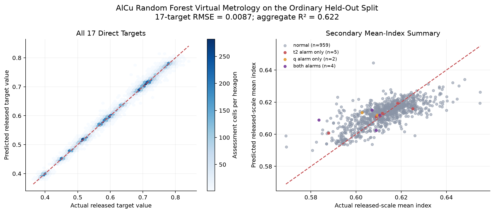
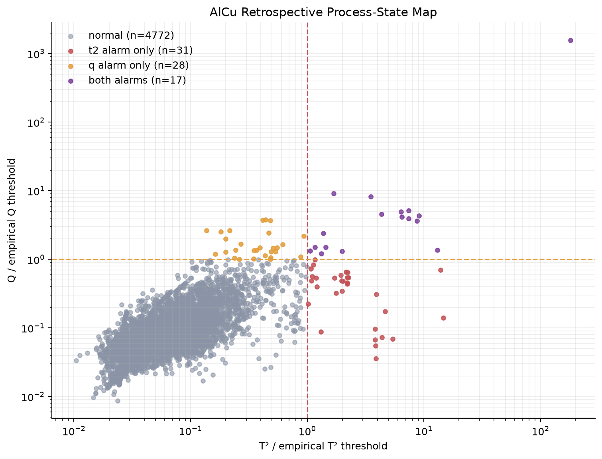
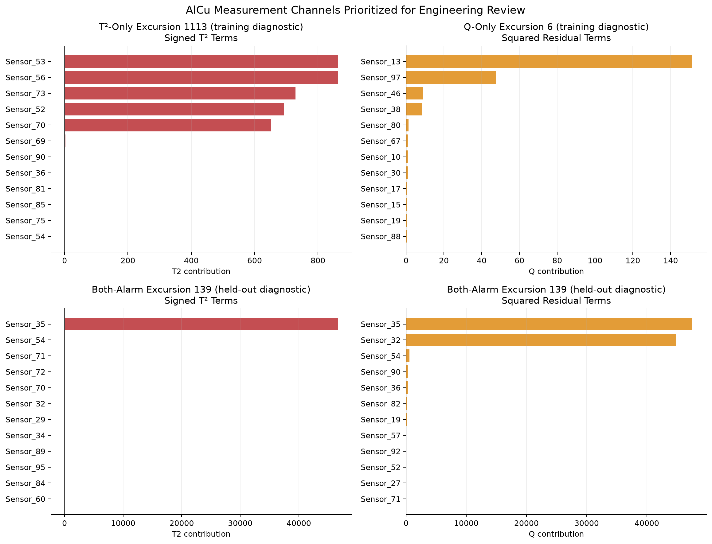
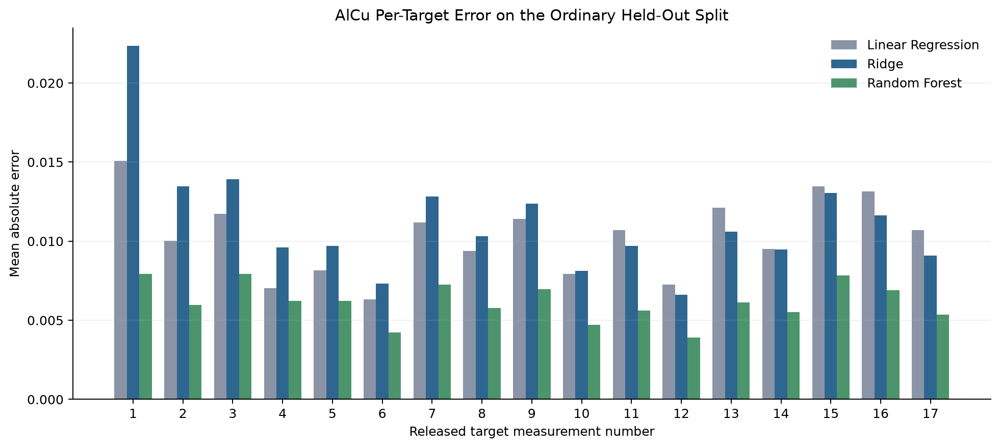
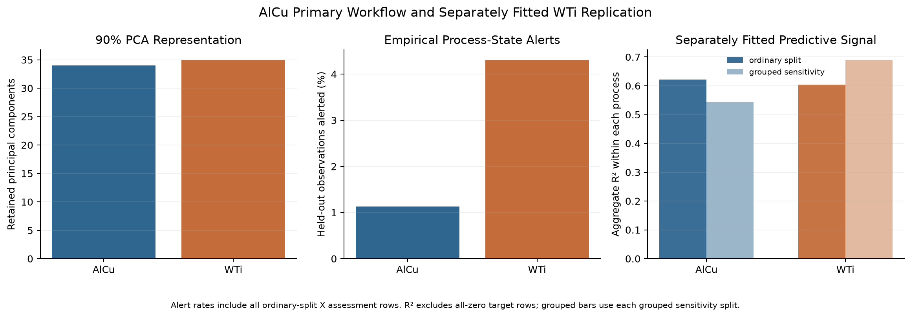

# Multivariate PVD Process Monitoring and Virtual Metrology

<p align="center"><a href="#overview">Overview</a> · <a href="#data">Data</a> · <a href="#method">Method</a> · <a href="#results">Results</a> · <a href="#limits">Limits</a> · <a href="#usage">Usage</a> · <a href="#references">References</a> · <a href="#terms">Terms</a></p>

I wanted to know two things about a chipmaking step that coats wafers with thin metal films. Can its sensor readings flag unusual process states, and can they predict the quality measurements taken afterward? I used a public, anonymized dataset with 4,848 AlCu records and 1,740 WTi records.

## Key results

- A Random Forest predicts all 17 released target measurements with an aggregate R² of 0.622 (AlCu) and 0.604 (WTi), and cuts RMSE by 41% (AlCu) and 43% (WTi) compared with Ridge regression.
- Principal component analysis (PCA) shrinks 95 AlCu inputs to 34 components and 108 WTi inputs to 35, keeping about 90% of the variance.
- On held-out rows, 1.13% of AlCu and 4.31% of WTi rows trip an alert. The alerted AlCu rows do not show a clear shift in released output.
- Keeping rows with identical target profiles together raised AlCu Random Forest RMSE by 6.4% and lowered R² from 0.622 to 0.543. WTi improved to 0.690.



## Overview

The project uses physical vapor deposition (PVD) process data for two jobs. The first is a retrospective look at the multivariate process state. The second is virtual metrology, which predicts the measured targets from the process inputs.

AlCu is the main analysis. WTi repeats the same workflow with its own separately fitted models.

I shrink the many correlated process inputs into a smaller monitoring view, rank the anonymous channels so excursions can be reviewed in order, and predict all 17 released target measurements directly.

> [!NOTE]
> <sub>PVD: step that deposits thin metal films on wafers · AlCu, WTi: the two metal layers in the data · virtual metrology: predicting a measurement from process inputs · target: one of 17 released measurements · excursion: a record far from the typical process state</sub>

## Data

The data come from Infineon's public
[Advanced Process Control and Statistical Process Control Data for Thickness Prediction of AlCu and WTi Metal Layer in Semiconductor Manufacturing](https://doi.org/10.5281/zenodo.16881338).

| Process | Input columns | Released targets | Rows |
|---|---:|---:|---:|
| AlCu | 97 | 17 | 4,848 |
| WTi | 108 | 17 | 1,740 |

My four local CSV files are unchanged copies of the release, and they match its MD5 checksums. Git ignores them.

Amina Mević, Andreas Laber, and Senka Krivić published the dataset under
[CC BY 4.0](https://creativecommons.org/licenses/by/4.0/). Download steps and checksums are in [`data/raw/README.md`](data/raw/README.md).

> [!IMPORTANT]
> The release leaves out physical units, inverse scaling, timestamps, equipment identifiers, measurement-point coordinates, specifications, and fault labels. So every number here stays on the released scale. The mean index and reference-profile deviation are summaries I derived for engineering review. They are not physical thickness or physical uniformity.

[Audit, splits and zero-record handling](docs/data-and-validation.md)

Sources: data/raw/README.md, results/audit/*.csv

## Method

1. Check file identity, shapes, missing values, duplicates, and X/Y row counts ([01_data_audit.py](src/01_data_audit.py)).
2. Validate on a fixed 80/20 split first. Then validate again with rows that share exactly the same target profile kept together. I don't assume that equal profiles are duplicate wafers ([02_preprocess_and_quality.py](src/02_preprocess_and_quality.py)).
3. Keep the all-zero target records for process-state monitoring. Leave them out of the main Y-based models, and run checks with and without them. I don't know what they mean.
4. Fit standardization and PCA on training data only. Keep the fewest components that explain at least 90% of the variance. Then compute Hotelling T² and Q/SPE, with empirical alert thresholds at the 99th percentile of the training set ([03_pca_monitoring.py](src/03_pca_monitoring.py), [04_excursion_analysis.py](src/04_excursion_analysis.py)).
5. Predict the 17 targets with multi-output Linear Regression and Ridge. I also include a fixed Random Forest, because it passed an improvement gate that I set in advance and that uses training data only. Each validation split has its own gate. Only the primary AlCu gate passes the model settings on to WTi ([05_virtual_metrology.py](src/05_virtual_metrology.py)).
6. Repeat steps 4 and 5 on WTi with models fitted only on WTi data ([06_wti_validation.py](src/06_wti_validation.py)).

> [!NOTE]
> <sub>Hotelling T²: distance from the typical state inside the PCA space · Q/SPE: variation the PCA model cannot reconstruct · Ridge: linear model with a penalty on large weights · Random Forest: average of many decision trees · 99th percentile: value that 99% of training rows fall below</sub>

## Results

| Result | AlCu | WTi |
|---|---:|---:|
| PCA components retained | 34 | 35 |
| Variance retained | 90.55% | 90.16% |
| Ordinary assessment alert rate | 1.13% | 4.31% |
| Random Forest 17-target MAE | 0.00615 | 0.00519 |
| Random Forest 17-target RMSE | 0.00870 | 0.00829 |
| Random Forest aggregate R² | 0.622 | 0.604 |
| Grouped-sensitivity Random Forest RMSE | 0.00926 | 0.00767 |

> [!NOTE]
> <sub>MAE: average absolute error · RMSE: typical error, with big misses counted more · R²: share of variation explained, 1 is perfect and below 0 is worse than predicting the mean · assessment: held-out rows not used for fitting · grouped: identical target profiles kept together</sub>

### Process-state monitoring

Of 970 held-out AlCu rows, 11 (1.13%) raised an alert, and only four tripped both the T² and Q/SPE alarms. Those 11 rows don't look different from normal rows in released output, since both clustered 95% intervals cross zero. WTi alerted 4.31% of its held-out rows.



The map plots each row's T² and Q/SPE as a multiple of its alert threshold. The two statistics catch different kinds of excursion. The alert categories only set review priority, and they are not fault labels.

> [!IMPORTANT]
> The thresholds are empirical alerts, not validated control limits. The four both-alarm rows had larger prediction error, but four rows is only a description and can't support a production rule.

[Full analysis](docs/process-monitoring.md)

Sources: results/alcu/alcu_pca_monitoring_summary.csv, results/alcu/alcu_alarm_category_counts.csv, results/alcu/alcu_held_out_quality_comparison.csv, figures/05_alcu_process_state_map.png

### Channel contributions

Contribution plots show which anonymous channels to look at first for a given excursion. For the held-out both-alarm row I picked, `Sensor_35` and `Sensor_54` rank high.



Each panel shows the top channels for one example row, with T² terms on the left and Q/SPE terms on the right.

> [!WARNING]
> The rankings help diagnosis, but they do not prove a physical cause.

[Full analysis](docs/process-monitoring.md)

Sources: results/alcu/alcu_excursion_contributions.csv, results/alcu/alcu_selected_excursions.csv, figures/06_alcu_excursion_contributions.png

### Virtual metrology

The Random Forest predicts all 17 released targets with an aggregate R² of 0.622 for AlCu and 0.604 for WTi. It cuts RMSE by 41% (AlCu) and 43% (WTi) compared with Ridge regression. Linear Regression did far worse, with a negative R² on both processes.

The prediction plot at the top shows the mean index only as a secondary engineering summary.



[Full analysis](docs/virtual-metrology.md)

Sources: results/alcu/alcu_virtual_metrology_metrics.csv, results/alcu/alcu_virtual_metrology_per_target.csv, results/wti/wti_virtual_metrology_metrics.csv, figures/08_alcu_virtual_metrology_predictions.png, figures/09_alcu_per_target_errors.png

### Grouped split check

Keeping identical target profiles together made the AlCu result a little worse, so the ordinary split is somewhat optimistic. Random Forest RMSE rose by 6.4% and aggregate R² fell from 0.622 to 0.543.

Even so, the grouped result still predicts the released-scale targets usefully. WTi did better under the grouped split, with R² of 0.690.

> [!IMPORTANT]
> The two processes use different released scales, so their errors do not rank them physically.

[Full analysis](docs/virtual-metrology.md)

Sources: results/alcu/alcu_virtual_metrology_metrics.csv, results/wti/wti_virtual_metrology_metrics.csv, results/audit/split_summary.csv

### WTi replication

The same workflow on WTi, with every model fitted only on WTi data, gives a similar picture. Its alert rate is higher at 4.31%, and its Random Forest R² is 0.604.



[Full analysis](docs/wti-replication.md)

Sources: results/wti/wti_pca_monitoring_summary.csv, results/comparison/cross_process_workflow_comparison.csv, figures/13_cross_process_workflow_comparison.png

The [`results/` guide](results/README.md) lists aggregate and per-target errors.

## Limits

- X/Y pairing goes by row position, because the release has no join key.
- There is no chronology or known-good baseline. So this is retrospective
  multivariate process-state monitoring, not formal chronological SPC.
- The thresholds are empirical alerts. They are not validated control limits,
  and their false-alarm rates are not independently calibrated.
- Without specifications there is no Cp/Cpk analysis. Without fault labels
  there is no validated fault detection.
- WTi is a second released process dataset, not an external fab qualification.

## Usage

Put the four downloaded CSV files in `data/raw/`, then run:

```bash
python3 -m venv .venv
source .venv/bin/activate
python -m pip install -r requirements.txt
export MPLCONFIGDIR=.matplotlib-cache
python src/01_data_audit.py
python src/02_preprocess_and_quality.py
python src/03_pca_monitoring.py
python src/04_excursion_analysis.py
python src/05_virtual_metrology.py
python src/06_wti_validation.py
```

Run the scripts in this order, because later ones read what earlier ones write.

## References

Release v1.0.

- [Infineon PVD APC/SPC dataset](https://doi.org/10.5281/zenodo.16881338), published under [CC BY 4.0](https://creativecommons.org/licenses/by/4.0/)
- [Technical report](report/technical_report.md): full method and interpretation
- [Results guide](results/README.md): main tables and supporting sensitivity outputs
- [Data and validation](docs/data-and-validation.md)
- [Process-state monitoring](docs/process-monitoring.md)
- [Virtual metrology](docs/virtual-metrology.md)
- [WTi replication and zero sensitivity](docs/wti-replication.md)

## Terms

- AlCu, WTi: the two metal layers in the data, aluminum-copper and tungsten-titanium
- Hotelling T²: distance from the typical process state inside the PCA space
- Q/SPE: variation that the PCA model cannot reconstruct
- MAE: average absolute error
- Mean index: average of the 17 released targets, a summary and not physical thickness
- PCA (principal component analysis): rewrites many correlated inputs as fewer combined ones
- PVD (physical vapor deposition): a chipmaking step that deposits thin metal films
- R²: share of variation explained, where 1 is perfect and below 0 is worse than predicting the mean
- RMSE: typical error, with big misses counted more
- Reference-profile deviation: how far a record's 17 targets sit from a reference profile, a statistical summary
- Ridge: a linear model with a penalty on large weights
- Random Forest: an average of many decision trees
- SPC (statistical process control): control charts for process stability
- Virtual metrology: predicting a measurement from process inputs instead of measuring it
