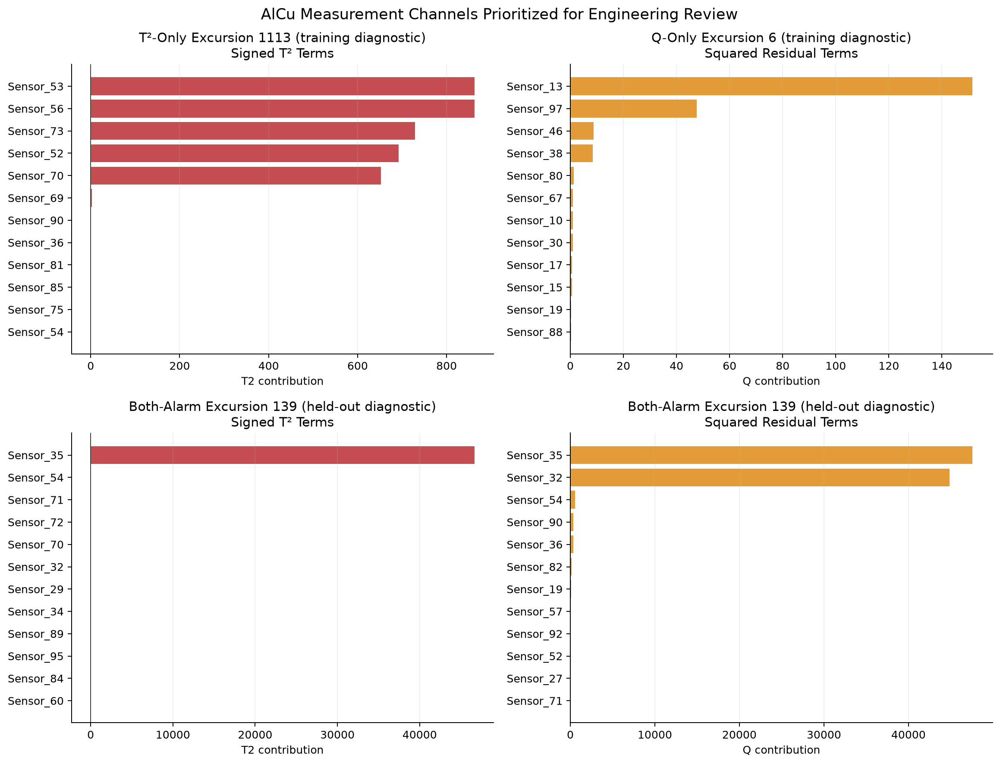

# Process-state monitoring

A principal component model of the process inputs flags 11 of 970 held-out AlCu rows, and those rows don't look different from normal ones in released output. The alerts only set review priority and are not fault labels. Back to the [README](../README.md).

> [!NOTE]
> PCA (principal component analysis): rewrites many correlated inputs as fewer combined ones · Hotelling T²: distance from the typical state inside the retained PCA space · Q/SPE: variation the retained PCA model cannot reconstruct · bootstrap: resampling to estimate a confidence interval · mean index: average of the 17 released targets

## What was measured

Inputs are standardized using ordinary training rows. PCA is then fit on those rows, and the smallest model that explains at least 90% of the variance is kept.

| Process | Model inputs | Retained components | Variance retained |
|---|---:|---:|---:|
| AlCu | 95 | 34 | 90.55% |
| WTi | 108 | 35 | 90.16% |

Hotelling T² measures distance inside the retained PCA space. Q/SPE measures the squared variation that the retained model does not reconstruct. Each alert threshold is the 99th percentile of that statistic on the ordinary training rows.

| Process | T² threshold | Q threshold | Assessment alerts |
|---|---:|---:|---:|
| AlCu | 258.819 | 60.379 | 11/970 (1.13%) |
| WTi | 419.905 | 60.568 | 15/348 (4.31%) |

These are empirical alert thresholds for looking back at the multivariate process state. They are not formal chronological SPC control limits or validated fault rules.

## Alert categories

Among the 970 held-out AlCu rows, 959 were normal, 5 alerted on T² only, 2 on Q only, and 4 on both. The four both-alarm rows are the only ones that tripped both statistics. The training rows split 3,813 normal, 26 T² only, 26 Q only, and 13 both.

Across all 4,848 AlCu rows, the process-state map shows 4,772 normal, 31 T² only, 28 Q only, and 17 both-alarm rows. Again, the categories only set review priority.

## Excursion examples

I picked three AlCu examples by taking the row with the largest threshold ratio in each non-normal category.

| Row | Role | State | T²/threshold | Q/threshold |
|---:|---|---|---:|---:|
| 1,113 | training diagnostic | T²-only | 14.70 | 0.14 |
| 6 | training diagnostic | Q-only | 0.44 | 3.77 |
| 139 | held-out diagnostic | both-alarm | 180.71 | 1,568.71 |

Contribution terms point to channels worth reviewing. `Sensor_53`, `Sensor_56`, and `Sensor_73` lead the first case. `Sensor_13`, `Sensor_97`, and `Sensor_46` lead the second.

`Sensor_35` and `Sensor_54` rank high for the held-out case.

These rankings help diagnosis, but they do not prove a physical root cause.

## Do alerts change the released output?

For the valid AlCu assessment rows, I ran a 2,000-sample bootstrap that resampled exact target-profile groups together.

| Released-scale summary | Alert minus normal mean | Clustered 95% interval |
|---|---:|---:|
| Mean index | -0.00610 | [-0.01355, 0.00071] |
| Reference-profile deviation | +0.00270 | [-0.00111, 0.00643] |

Both intervals include zero. So the 11 alerted rows do not show a clear shift in released output.

## Prediction error on alerted rows

Mean row MAE rises from 0.00611 on normal rows to 0.01263 on the four both-alarm rows. T²-only rows sit at 0.00644 and Q-only rows at 0.00794. Four rows are too few to base a production reliability rule on, so I'm only describing what happened.

## What it doesn't show

The monitoring has no chronology, no known-good period, no specifications, and no fault labels. It cannot support formal SPC limits, Cp or Cpk, or validated fault detection. Anonymous variables also cannot support claims about named equipment.

Sources: results/alcu/alcu_pca_monitoring_summary.csv, results/alcu/alcu_alarm_category_counts.csv, results/alcu/alcu_selected_excursions.csv, results/alcu/alcu_excursion_contributions.csv, results/alcu/alcu_held_out_quality_comparison.csv, results/alcu/alcu_model_error_by_state.csv, figures/05_alcu_process_state_map.png, src/03_pca_monitoring.py, src/04_excursion_analysis.py
