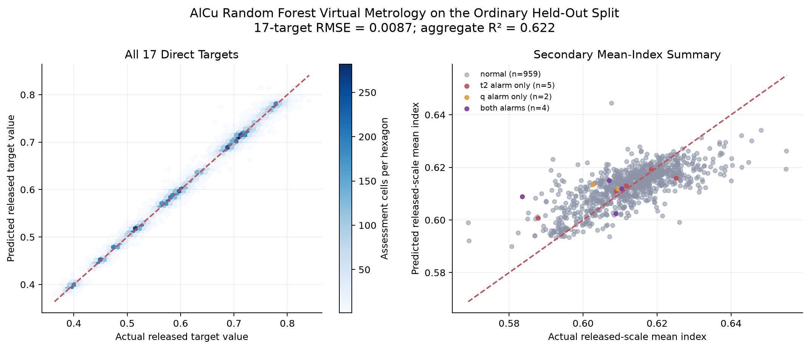
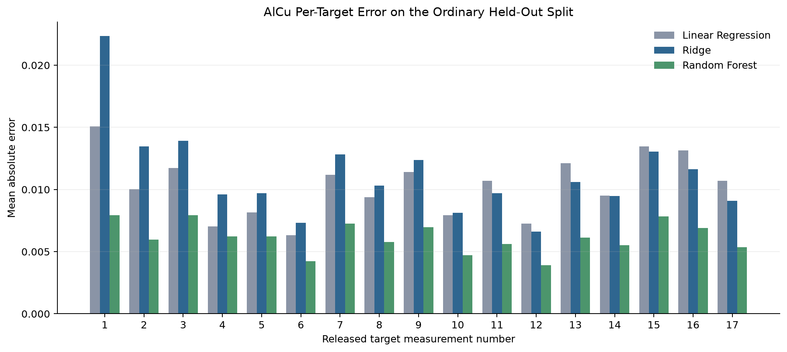

# Virtual metrology

A Random Forest predicts all 17 released targets with an aggregate R² of 0.622 for AlCu and 0.604 for WTi, and cuts RMSE by 41% (AlCu) and 43% (WTi) compared with Ridge regression. When I keep repeated target profiles together the AlCu score drops a little, so the ordinary split is slightly optimistic. Back to the [README](../README.md).

> [!NOTE]
> virtual metrology: predicting a measurement from process inputs · MAE: average absolute error · RMSE: typical error, with big misses counted more · R²: share of variation explained, 1 is perfect and below 0 is worse than predicting the mean · Ridge: linear model with a penalty on large weights · Random Forest: average of many decision trees

## What was measured

The task estimates all 17 released targets directly from the process inputs. Linear Regression and Ridge are the required baselines. Ridge is tuned with five-fold cross-validation on training data only, with scaling done inside each fold.

One Random Forest is kept. It uses 300 trees, minimum leaf size 5, 70% of features per split, and seed 42. It was added because it passed an improvement gate that was set in advance and uses training data only.

## Model choice

With seeds 11, 42, and 73, the Random Forest improves ordinary training-fold RMSE over Ridge by 39.0% to 39.2%.

This ordinary gate decides the main AlCu model and the settings passed to WTi. A separate gate on the grouped training data decides only the grouped AlCu result. Neither held-out set affects the other gate.

## Results on the ordinary split

| Process | Model | MAE | RMSE | Aggregate R² |
|---|---|---:|---:|---:|
| AlCu | Linear Regression | 0.01030 | 0.10607 | -55.257 |
| AlCu | Ridge | 0.01118 | 0.01486 | 0.001 |
| AlCu | Random Forest | 0.00615 | 0.00870 | 0.622 |
| WTi | Linear Regression | 0.01819 | 0.18202 | -176.846 |
| WTi | Ridge | 0.00721 | 0.01458 | -0.172 |
| WTi | Random Forest | 0.00519 | 0.00829 | 0.604 |

A negative R² means the model does worse than simply predicting each target's mean. A few rare large errors cause the poor Linear Regression RMSE. The Random Forest result is much steadier.

## Error by target

The Random Forest beats both baselines on every one of the 17 AlCu targets in the per-target error chart. The table lists its error for each target on both processes.

| Target | AlCu MAE | AlCu RMSE | WTi MAE | WTi RMSE |
|---:|---:|---:|---:|---:|
| 1 | 0.00792 | 0.01143 | 0.00455 | 0.00693 |
| 2 | 0.00599 | 0.00858 | 0.00704 | 0.01096 |
| 3 | 0.00793 | 0.01085 | 0.00457 | 0.00722 |
| 4 | 0.00624 | 0.00876 | 0.00413 | 0.00670 |
| 5 | 0.00623 | 0.00860 | 0.00645 | 0.01031 |
| 6 | 0.00423 | 0.00580 | 0.00442 | 0.00715 |
| 7 | 0.00726 | 0.00982 | 0.00335 | 0.00534 |
| 8 | 0.00576 | 0.00782 | 0.00553 | 0.00875 |
| 9 | 0.00696 | 0.00960 | 0.00372 | 0.00592 |
| 10 | 0.00472 | 0.00649 | 0.00471 | 0.00755 |
| 11 | 0.00562 | 0.00788 | 0.00417 | 0.00649 |
| 12 | 0.00390 | 0.00545 | 0.00669 | 0.01023 |
| 13 | 0.00613 | 0.00857 | 0.00394 | 0.00603 |
| 14 | 0.00551 | 0.00745 | 0.00662 | 0.00988 |
| 15 | 0.00783 | 0.01080 | 0.00616 | 0.00927 |
| 16 | 0.00690 | 0.00975 | 0.00653 | 0.01010 |
| 17 | 0.00537 | 0.00744 | 0.00573 | 0.00886 |

Full-precision MAE, RMSE, and R² values are in
[`alcu_virtual_metrology_per_target.csv`](../results/alcu/alcu_virtual_metrology_per_target.csv) and
[`wti_virtual_metrology_per_target.csv`](../results/wti/wti_virtual_metrology_per_target.csv).

## Grouped split sensitivity

Under the grouped split, AlCu Random Forest RMSE goes from 0.00870 to 0.00926 and R² goes from 0.622 to 0.543. That is a 6.4% rise in RMSE. WTi goes the other way, from 0.00829 and 0.604 to 0.00767 and 0.690.

Repeated profiles make the ordinary AlCu score a bit optimistic, but the grouped result still carries useful signal on the released scale. The two processes use different released scales, so their raw errors do not rank them physically.

## What it doesn't show

These are predictions of released-scale values, so they aren't physical metrology. The mean index and reference-profile deviation are secondary summaries and don't measure physical thickness or uniformity. I haven't shown that any of this is ready for production.

Sources: results/alcu/alcu_virtual_metrology_metrics.csv, results/wti/wti_virtual_metrology_metrics.csv, results/alcu/alcu_virtual_metrology_per_target.csv, results/wti/wti_virtual_metrology_per_target.csv, results/alcu/alcu_ridge_cv_results.csv, results/alcu/alcu_random_forest_stability.csv, results/alcu/alcu_model_error_by_state.csv, figures/08_alcu_virtual_metrology_predictions.png, figures/09_alcu_per_target_errors.png, src/05_virtual_metrology.py
