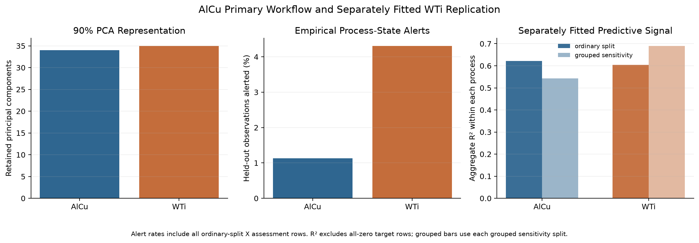

# WTi replication and zero sensitivity

I ran the same workflow on the WTi process, with every model fitted only on WTi data, and got similar results: 35 components, a 4.31% alert rate and a Random Forest R² of 0.604. The one all-zero target record matters most when it lands in the held-out set. Back to the [README](../README.md).

> [!NOTE]
> replication: repeating the workflow on a second dataset · grouped split: rows with identical target profiles kept together · RF: Random Forest · all-zero record: a row where every target is 0, meaning unknown

## What was repeated

The WTi scaler, PCA model, thresholds, Ridge penalty, and final fits all use WTi training data. Before refitting its Random Forest, the script checks that the settings match the model that the ordinary AlCu training-only gate accepted.

| Measure | AlCu | WTi |
|---|---:|---:|
| Input columns used by the model | 95 | 108 |
| Retained components | 34 | 35 |
| Variance retained | 90.55% | 90.16% |
| Held-out alert rate | 1.13% | 4.31% |
| Random Forest RMSE, ordinary split | 0.00870 | 0.00829 |
| Random Forest R², ordinary split | 0.622 | 0.604 |
| Random Forest RMSE, grouped split | 0.00926 | 0.00767 |
| Random Forest R², grouped split | 0.543 | 0.690 |

## Alerts and released output

The 14 alerted valid WTi assessment rows differ from normal rows by +0.00186 in mean index. The clustered 95% interval is [-0.00420, 0.00768].

The interval for reference-profile deviation also crosses zero. That agrees with AlCu, where the alerted rows don't show a clear shift in released output either.

The WTi alert count of 15 in 348 rows includes the all-zero record, which sits in the held-out set and trips both alarms. That leaves 14 alerted rows with valid targets.

## All-zero record sensitivity

Each process has one record where every target is zero, and I don't know what it means. The table shows Random Forest RMSE with that record left out (the main setting) and put back in.

| Process and split | Zero location | RF RMSE excluded | RF RMSE included |
|---|---|---:|---:|
| AlCu ordinary | training | 0.008698 | 0.008715 |
| AlCu grouped | assessment | 0.009258 | 0.020967 |
| WTi ordinary | assessment | 0.008285 | 0.041549 |
| WTi grouped | training | 0.007666 | 0.008124 |

The record matters most when it lands in the assessment set. That is why I leave it out of the main target-based evaluation, without guessing at what it means.

## What it doesn't show

WTi is a second public dataset, not an external fab qualification. AlCu and WTi use different released scales, so their raw errors do not rank the processes physically.

Sources: results/wti/wti_pca_monitoring_summary.csv, results/wti/wti_virtual_metrology_metrics.csv, results/wti/wti_held_out_quality_comparison.csv, results/wti/wti_zero_output_model_sensitivity.csv, results/alcu/alcu_zero_output_model_sensitivity.csv, results/comparison/cross_process_workflow_comparison.csv, figures/13_cross_process_workflow_comparison.png, src/06_wti_validation.py
